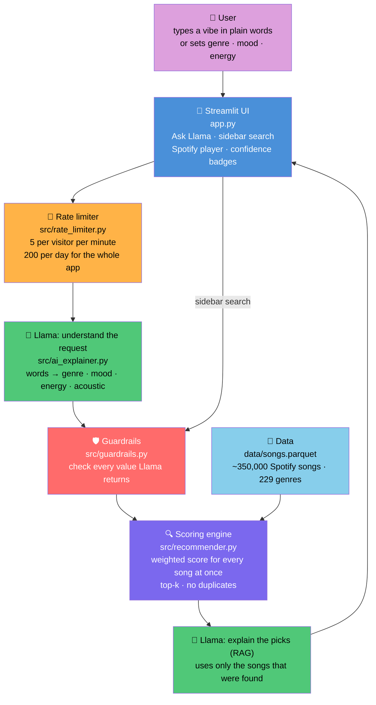
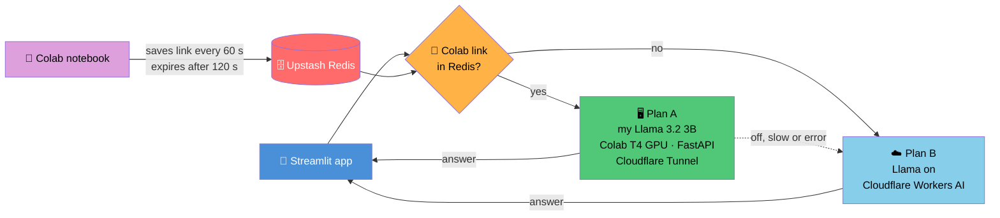
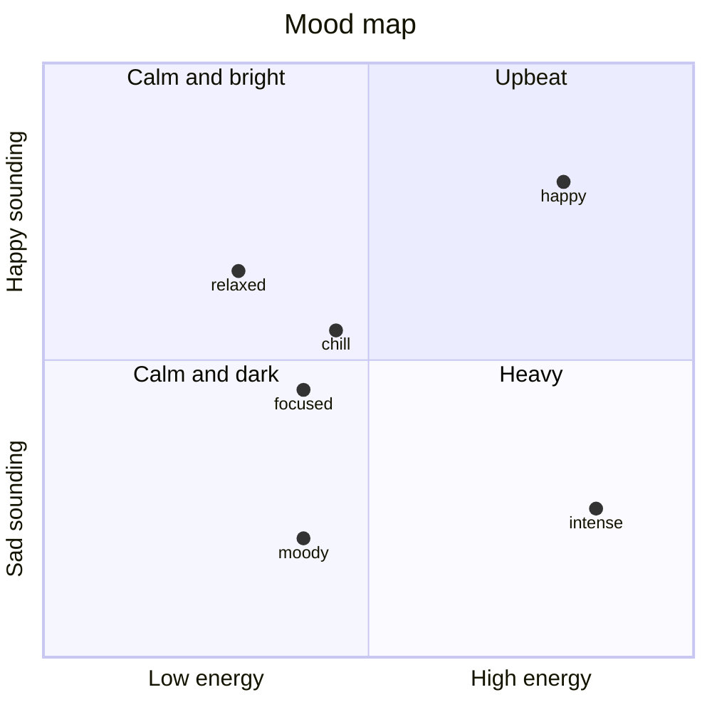
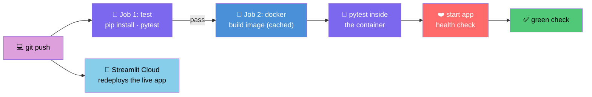

# 🎵 Music Recommendation Engine

**Describe a vibe in plain words and get real songs that match it.**

[**Try the live app**](https://music-recommendation-engineai.streamlit.app/) · [Watch the demo (earlier version)](https://www.loom.com/share/2db33ebdefe9455abf95830b8e742faf)


---

## The problem

People describe music by feeling: *"chill worship music for a rainy night."* Most apps make you search by song or artist names. New users have no listening history (the **cold start problem**), and recommendations rarely explain themselves, so they are hard to trust.

This engine takes plain words, searches about **350,000 real Spotify songs**, and explains every pick.

---

## System architecture



1. **Llama reads your request** and turns it into settings: genre, mood, energy, and acoustic or not.
2. **Guardrails check the answer** against the real list of genres and moods. The model is never trusted blindly.
3. **The scoring engine ranks every song at once** with pandas and NumPy, in about 0.5 seconds.
4. **Llama explains the picks** using only the songs that were found (retrieval augmented generation), so it can't make up facts.
5. **You listen right away** with a built-in Spotify player.

You can also skip Llama and set everything yourself in the sidebar.

---

## Self-hosted Llama with automatic fallback

The app can use two Llamas. It always tries my own first.



- **Plan A: my own Llama 3.2 3B** runs on a Google Colab T4 GPU, served with FastAPI and reached through a Cloudflare tunnel. The notebook saves its public link in Upstash Redis every minute, and the link expires after 2 minutes, so when the notebook stops, the app knows right away.
- **Plan B: Llama on Cloudflare Workers AI.** If Colab is off, slow, or broken, the app switches over automatically. It tries several models in order and remembers the one that works.

The app shows which one answered: **Colab (self-hosted)** or **Cloudflare**. The server notebook is [`music_recommendation_engine.ipynb`](music_recommendation_engine.ipynb).

---

## The scoring formula

| Part | Weight | How it is scored |
|---|---|---|
| Genre | 35% | Whole-word match: "rock" matches "classic rock," but "rap" does not match "trap" |
| Mood | 25% | Partial points: the closer a song is to the mood's spot on an energy and happiness map, the more points |
| Energy | 20% | `1 - abs(song_energy - target_energy)` |
| Popularity | 15% | Breaks near-ties toward songs people actually know |
| Acoustic | 5% | Acousticness if you like acoustic sound, otherwise the opposite |



The same song is never shown twice. Every result shows a confidence level (**High** ≥ 0.7, **Medium** ≥ 0.45, **Low** below that) and a plain-English reason.

**Why partial mood points?** With all-or-nothing moods, calm English worship songs were labeled "moody" (they sound a little sad) and got zero points in a "chill" search. Measuring distance on the mood map fixed that.

---

## Engineering



- **CI:** GitHub Actions runs the pytest tests on every push and pull request.
- **Docker:** CI builds the image with layer caching, runs the tests inside it, and checks that the app starts and passes a health check.
- **Rate limiting:** 5 Llama requests per visitor per minute (sliding window), and 200 per day for the whole app, counted in Redis. If Redis is down, the app keeps working instead of blocking people. The sidebar search never uses Llama, so it always works.
- **Fast data:** songs are stored as compressed Parquet (15 MB) and cached, so they load in about 0.1 seconds.
- **Logging:** JSON-lines logs for every request, including which Llama answered.

---

## The data

The songs come from the Kaggle dataset [Spotify Dataset 1921-2020, 600k+ Tracks](https://www.kaggle.com/datasets/yamaerenay/spotify-dataset-19212020-600k-tracks). I joined each song with its artists' genres, removed podcasts and audiobooks, kept songs with popularity of 20 or more, and tagged Christmas songs by title (words like "Christmas," "Jingle Bell" and "Silent Night"). That leaves **347,778 songs**.

An earlier version used a smaller 114,000-song dataset. It had only about 1,000 gospel songs, almost all Brazilian, and no Christmas genre at all, so searches like "Christmas music" returned unrelated songs. Switching data fixed that.

---

## Run it yourself

With Docker:

```bash
git clone https://github.com/William-franklyn/music-recommendation-engine.git
cd music-recommendation-engine
docker build -t music-engine .
docker run -p 8501:8501 music-engine
```

Then open http://localhost:8501.

Without Docker:

```bash
pip install -r requirements.txt
streamlit run app.py
```

Song search works without any keys. For Llama, put these in a `.env` file (and run Docker with `--env-file .env`):

```
CLOUDFLARE_API_TOKEN=...
CLOUDFLARE_ACCOUNT_ID=...
KV_REST_API_URL=...        # optional: self-hosted Llama and the daily limit
KV_REST_API_TOKEN=...
```

Run the tests and the evaluation:

```bash
pytest -q
python eval.py
```

---

## Design decisions

- **Weighted scoring instead of a trained model:** every score can be explained, factor by factor, and no training data is needed.
- **Llama for language, code for ranking:** Llama only translates words into settings and explains results. The ranking itself is plain, testable math.
- **RAG for explanations:** Llama only sees the songs that were found, so it can't invent songs or details.
- **Graceful degradation everywhere:** no keys, no Colab, or no Redis, and the app still works.

---

## Tech stack

Python · Streamlit · pandas · NumPy · Meta Llama 3.2 and 3.3 · Hugging Face Transformers · FastAPI · Cloudflare Workers AI · Cloudflare Tunnel · Upstash Redis · Docker · GitHub Actions · pytest · Google Colab (T4 GPU)

## Coming next

- Store the song data in AWS S3
- Update `score_breakdown.py` to the new formula

*See [model_card.md](model_card.md) for the reflection and bias analysis.*

Built by [William Frank Mahunda](https://www.linkedin.com/in/william-frank-mahunda) · [Portfolio](https://william-frank-mahunda.vercel.app/) · [GitHub](https://github.com/William-franklyn)
